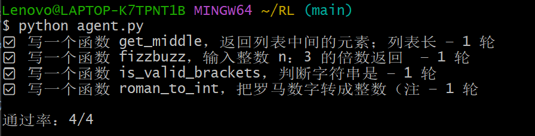
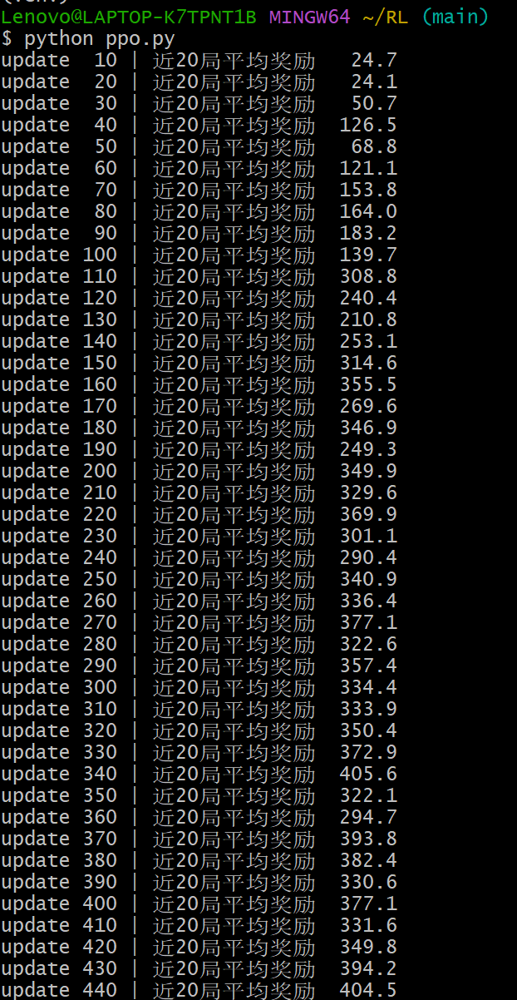
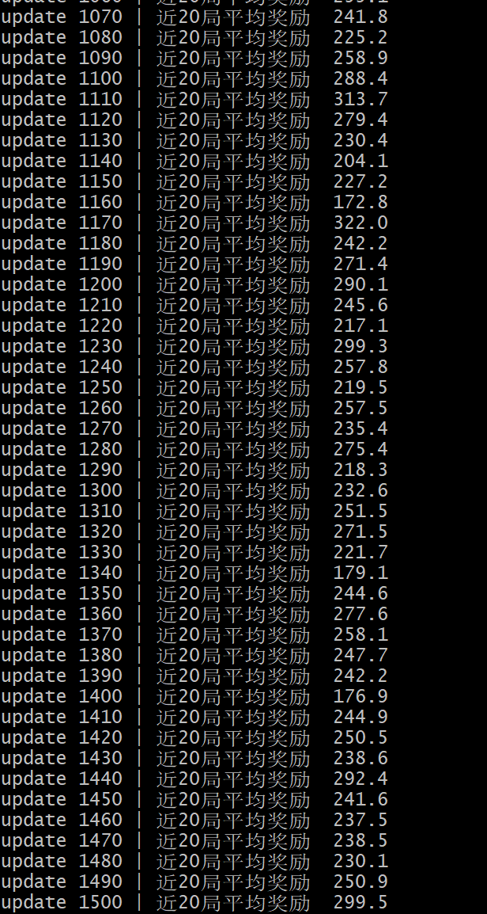

  # 大模型与强化学习项目

  两个独立的小项目，分别对应「大模型编程」和「强化学习」两个方向：

  - **`agent.py`** —— 基于 LLM 的自主代码生成 Agent
  - **`ppo.py`** —— PPO 强化学习算法实现

  ---

  ## 项目一：LLM 代码生成 Agent（`agent.py`）

  ### 简介

  基于 LLM 的自主代码生成 Agent，实现「生成代码 → 执行 → 报错喂回 → 迭代修复」的**自我修正闭环**。传统 LLM
  代码生成是「一次生成、错了就错」，本 Agent
  把「测试是否通过」作为反馈信号，失败时把报错喂回模型让它自己修，直到通过或达到最大迭代次数。

  ### 工作流程

  ```
  任务 → LLM 生成代码 → 执行测试 → 通过？→ 结束
                            │ 失败
                            ▼
                    报错喂回 LLM → 重新生成 → …（最多 5 轮）
  ```

  ### 技术栈

  | 环节 | 方案 |
  |---|---|
  | 大模型 | DeepSeek（deepseek-chat） |
  | 代码执行 | subprocess + 临时文件 |
  | 测试 | assert 断言 |

  ### 运行

  ```bash
  python agent.py
  ```

  ### 结果

  4 个编程任务（质数判断、去重保序、第二大数、元音统计）**通过率 4/4**。

  > 

  ### 关键发现：反馈质量决定收敛上限

  - `is_valid_brackets`（合法括号）任务最初 **5 轮都修不动**
  - **诊断**：测试写成复合断言，失败时只报 `AssertionError`，模型不知道具体哪个 case 错，只能瞎猜
  - **修复**：把复合断言拆成带消息的独立断言，报错精确到「第几个 case 错」
  - **结论**：自我修复能不能收敛，**不在模型多强，而在反馈信息的质量**

  ---

  ## 项目二：PPO 强化学习（`ppo.py`）

  ### 简介

  从零实现 PPO（Proximal Policy Optimization）算法，在 CartPole 环境上训练。CartPole
  的任务是控制小车保持杆子平衡，每撑一步 +1 分，满分 500。

  ### 核心组件

  | 组件 | 作用 | 代码位置 |
  |---|---|---|
  | Actor-Critic | 一个网络两输出头：Actor 选动作、Critic 估价值 | `class ActorCritic` |
  | GAE 广义优势估计 | 算「这一步比平均水平好多少」 | `compute_gae` |
  | PPO 裁剪目标 | 把策略更新幅度夹在 `[1-ε, 1+ε]`，防一步改崩 | `torch.clamp(ratio, ...)` 那段 |

  ### 技术栈

  - PyTorch（CPU）
  - Gymnasium（CartPole-v1）

  ### 运行

  ```bash
  python ppo.py
  ```

  ### 结果

  - 奖励从 **~24 涨到 ~400**，学习曲线清晰上涨
  - 未稳定收敛到满分 500，后期在 200~400 震荡

  > 
  > 

  ### 关键发现：训练稳定性

  - 后期 reward 在 200~400 震荡，偶尔掉到 58（**灾难性遗忘**）
  - **诊断**：固定学习率 + 熵系数未做**退火（annealing）**，后期策略在最优解附近反复横跳
  - **启示**：标准实现（如 CleanRL）都会对学习率和熵做线性衰减来保证稳定收敛

  ---

  ## 环境依赖

  ```txt
  openai
  python-dotenv
  torch
  numpy
  gymnasium
  ```

  ---